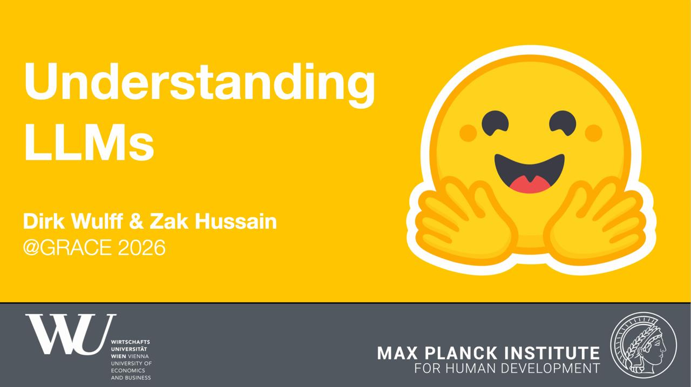

## Understanding-LLMs-UniBas-2026



This course provides a conceptual foundation for understanding how modern LLMs work and how to use them effectively in research.

By [Dirk Wulff](https://www.wu.ac.at/en/bads/team/dirk-wulff) and [Zak Hussain](https://www.linkedin.com/in/zakir-a-s-hussain/)

### Schedule

<font style="font-size:10">09:00 AM - 09:30 AM: Welcome & Intro<br>
09:30 AM - 10:30 AM: Talk: Intro to LLMs<br>
10:30 AM - 10:45 AM: Break<br>
10:45 AM - 11:45 AM: Talk: Intro to Transformers<br>
11:45 AM - 12:30 PM: Talk & Demo: Intro Hugging Face<br>
12:30 PM - 02:00 PM: Lunch<br>
02:00 PM - 03:00 PM: Talk: Intro to Text Generation and Prompting<br>
03:00 PM - 03:30 PM: Demo: Chat with HuggingChat<br>
03:30 PM - 03:45 PM: Break<br>
03:45 PM - 04:30 PM: Talk: LLMs in Science<br>
04:30 PM - 05:15 PM: Discussion<br>
05:45 PM - 06:00 PM: Wrap-up<br>
</font>

### Resources
<a href="https://doi.org/10.3758/s13428-024-02455-8">Hussain, Binz, Mata, & Wulff (2024). A tutorial on open-source large language models for behavioral science. *Behavior Research Methods*, 1-24.
</a>
```
@article{hussain2024tutorial,
  title={A tutorial on open-source large language models for behavioral science},
  author={Hussain, Zak and Binz, Marcel and Mata, Rui and Wulff, Dirk U},
  journal={Behavior Research Methods},
  pages={1--24},
  year={2024},
  publisher={Springer}
}
```

[Hugging face documentation](https://huggingface.co/docs)<br>
[Hugging face book](https://transformersbook.com/)<br>
[But what is a GPT (3Blue1Brown)](https://www.youtube.com/watch?v=wjZofJX0v4M&list=PLZHQObOWTQDNU6R1_67000Dx_ZCJB-3pi&index=5)<br>

### Installation Instructions

#### Hugging Face and Meta Llama License
1. Create a hugging Face account (https://huggingface.co/join).
2. Navigate to [your Hugging Face profile settings](https://huggingface.co/settings/tokens) to generate an API token (+Create new token). Set the token type to 'Read' and give it a name (e.g., 'understanding-LLMs').

#### Google Colab and GitHub Repository
4. If you do not have a Google account, you will need to create one (this can be deleted after the workshop).
5. Navigate to Google Drive (https://drive.google.com/).
6. In the top-left, click New > More > Colaboratory. If you do not see Colaboratory, you may need to click "Connect more apps", 
search for 'Colaboratory', and install it. Then click New > More > Colaboratory.
7. Copy the following code snipped into the first cell of the notebook. Run it (```shift + enter``` or click &#9658; button) to mount your Google Drive to the Colab environment.
A pop-up will ask you to connect; click through the steps to connect your Google Drive to Colab (you will have to do this
every time you open a new notebook).
```
from google.colab import drive
drive.mount("/content/drive")
```
8. Create a second cell in your notebook using the "+ Code" button that appears when you hover your cursor right under the first cell. Copy and run the following code snippet in the second cell of your notebook to clone the GitHub repository to your Google Drive :
```
%cd /content/drive/MyDrive
!git clone https://github.com/Zak-Hussain/Understanding-LLMs-UniBas-2026.git
```
9. Go back to your Google Drive and navigate to the folder "Understanding-LLMs-UniBas-2026". You can then click on `hf_intro.ipynb` and start working through the notebook. 

## Evaluation

Please fill out the course evaluation [here](https://evasys.unibas.ch/evasys/online.php?p=4PNX6).  
